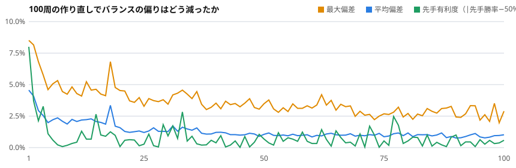

# ReForge — AIにカードゲームを100回作り直させる工場

ルール → AIプレイヤー → 自己対戦 → 壊れた札・ルールの検出と修正、を100周回し、ブラウザで遊べる形に出力するプロジェクト。初版は意図的に壊してあり、100周の調整でどこまで直るかを記録している。

**遊ぶ:** https://reforge.mao-miyaza.workers.dev （スライダーで第0〜100周のどの版でも遊べる）



| 指標 | 初版 | 100周後 |
|---|---|---|
| カード勝率の最大偏差（50%から） | 9.4% | 2.0% |
| 先手勝率 | 57.1% | 50.0% |
| カード変更 | — | 106回 |
| 王者の戦術の入れ替わり | — | 18回 |

測定は王者AI同士の自己対戦（ランダムデッキ、席替えで2戦ずつ、最終測定は約12,000戦）。

## しくみ（1周）
1. **戦術の進化** 8個の重みを持つAIを6通り変異させ、旧王者に57%超で勝てば交代。
2. **自己対戦** 王者同士でランダムデッキを戦わせ、「そのカードが入ったデッキの勝率」を測る。
3. **修正** 50%から大きく外れたカードを弱体化/強化（閾値は周を追って厳しくなる）。先手有利は「後手の体力ボーナス」で補正。

## 限界（正直に）
- AIは重み付きヒューリスティックで、先読み探索ではない。発見される戦術は重みの調整の範囲。
- バランスはこのAIの癖に依存する。人間の対戦で同じになる保証はない。
- 残る偏差約2%は、対戦数による測定誤差の範囲。
- 後手補正を「初期手札+1」「エネルギー+1」のような粗い段階にした初期版では、先手勝率が64%と13%を往復した。体力ボーナスの細かい調整に変えて解決した。

## 使い方
```bash
node tune.mjs 100          # 100周。PAIRS=3000 で1周の対戦数を変更
node build.mjs             # dist/ と docs/progress.svg を作る
npx http-server . -p 8771  # ローカルで web/index.html を開く
```

構成: `engine.mjs`（ルール）/ `bots.mjs`（AI）/ `sim.mjs`（自己対戦）/ `tune.mjs`（調整ループ）/ `web/`（画面）/ `data/history.json`（全周の履歴）。

## 次の予定
デッキ単位の進化でメタの多様性を測る、探索型AI（MCTS）との比較、LLMによるカード・ルール生成を工場に組み込む。
